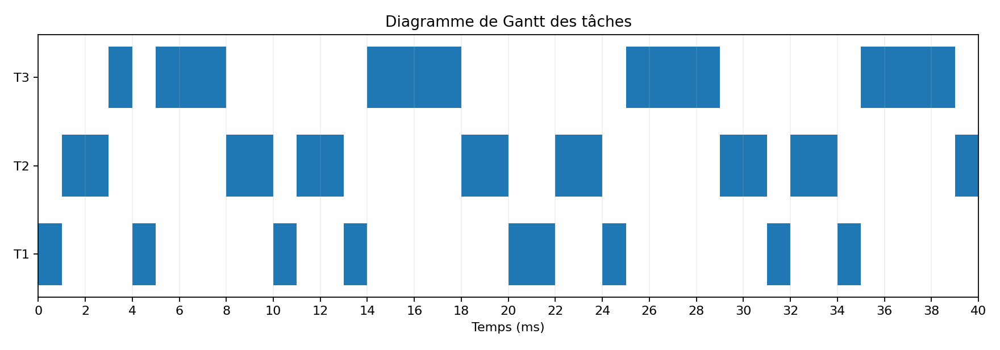
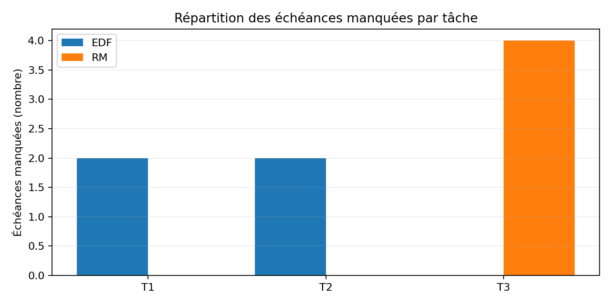

# Adaptive Real-Time AI Scheduler

**Reproducible educational prototype for deadline-aware AI inference scheduling.**

This repository connects real-time systems fundamentals (**EDF**, **Rate Monotonic**, response-time analysis, demand-bound functions) with CPU neural-network inference benchmarking. It is being developed as a small research-oriented portfolio project relevant to scheduling constrained AI workloads on edge systems.

> **Scope and scientific honesty:** This is a single-processor, integer-time educational simulation with independent periodic tasks, idealized preemption, fixed costs and zero overhead. Measured inference p50/p95/observed maxima are **not certified WCET bounds**. GPU/TPU scheduling, thermal constraints and real-time guarantees on hardware are future work. No claim of a deadline guarantee follows from the finite simulations alone.

## Project structure

```text
adaptive-real-time-ai-scheduler/
├── README.md
├── docs/COURSES_FR.md               # Pedagogical explanations (French)
├── lessons/
│   ├── lesson1/scheduler.py         # Periodic task simulation, EDF / RM
│   ├── lesson2/scheduler_metrics.py # Response times, missed deadlines, CSV/Gantt
│   ├── lesson2/test_metrics.py
│   ├── lesson2/edf_simulation_offsets.py
│   ├── lesson2/edf_rm_step_by_step.py
│   ├── lesson3/analyse_ordonnancabilite.py # RTA, DBF, scheduling examples
│   ├── lesson3/test_analyse.py
│   ├── lesson3/benchmark_inference_cpu.py # Untrained MLP microbenchmark
│   └── lesson4/                    # Trained Fashion-MNIST models + integration
├── requirements-core.txt
├── requirements-ml.txt
└── .github/workflows/tests.yml
```

## Quick start: EDF and RM without ML

Requires Python 3.11+.

```bash
python -m venv .venv
source .venv/bin/activate   # Windows PowerShell: .venv\Scripts\Activate.ps1
python -m pip install -r requirements-core.txt

python lessons/lesson1/scheduler.py
python lessons/lesson2/scheduler_metrics.py --scenario overload --horizon 40
python lessons/lesson3/analyse_ordonnancabilite.py
```

### Run unit tests

```bash
python -m unittest discover -s lessons/lesson2 -p 'test_*.py' -v
python -m unittest discover -s lessons/lesson3 -p 'test_*.py' -v
```

## Results from deterministic simulation

| Scenario | CPU utilization | EDF deadline misses | RM deadline misses |
|:--|--:|--:|--:|
| Baseline: `(1,4,4), (2,5,5), (2,10,10)` | 85% | 0 / 22 | 0 / 22 |
| Overload: `(1,4,4), (2,5,5), (4,10,10)` | 105% | 4 / 22 | 4 / 22 |

Results above are for 40 ms simulated time, one processor, with synchronized releases, 1-ms execution steps, and no execution overhead. EDF and RM can miss *different tasks* even when their aggregate miss counts are equal.

A separate scenario, `T1=(2,5,5), T2=(2,7,7), T3=(3,12,12)`, has `U≈93.57%`: EDF is schedulable under the implicit-deadline model; RM gives T3 worst-case response time **13 ms > D3=12 ms**. The result illustrates why scheduling policy matters.

## Reference plots (deterministic example)





The figures show **simulated** task scheduling, not real measured inference times. Regenerate them with `python lessons/lesson2/scheduler_metrics.py --scenario overload --horizon 40`.

## Next step: trained model inference (Lesson 4)

Install the optional ML dependencies:

```bash
python -m pip install -r requirements-ml.txt
python lessons/lesson4/smoke_test.py
python lessons/lesson4/train_models.py --epochs 2 --batch-size 128
python lessons/lesson4/benchmark_trained.py --model-dir outputs/models --samples 200
python lessons/lesson4/compare_schedulers.py --benchmarks outputs/benchmarks.json
```

The first training run downloads **Fashion-MNIST** unless its data are already cached. Do not commit downloaded datasets or checkpoint binaries: they are ignored via `.gitignore`. Benchmarks vary across hardware and should be rerun on the target device.

See [Lesson 4 instructions](lessons/lesson4/README.md), the [French lesson 4 tutorial](docs/COURS4_FR.md) and the [French course notes](docs/COURSES_FR.md).

For publishing this project to GitHub step by step, see [GitHub publication instructions in French](docs/GITHUB_PUBLISH_FR.md).

## Research questions and roadmap

1. How do scheduling policies affect missed deadlines under interference and overload?
2. How does model size change measured CPU inference latency and predictive accuracy?
3. How can a scheduler trade inference quality against execution demand while maintaining acceptable timing performance?
4. Future: justified execution-time bounds, independent-task assumptions, multi-device scheduling (CPU/GPU/TPU), non-preemptive accelerators, thermal/energy constraints, and accuracy-aware policies.

## Reproducibility and limitations

This project provides source code and tests rather than claiming experimental hardware guarantees. Training accuracy and inference latency depend on actual local runs; **no invented experimental results** are reported. The finite simulation is not a schedulability proof. The training scripts record metrics and save model weights locally.

## References

- Giorgio Buttazzo, *Hard Real-Time Computing Systems*, Springer.
- MIT 6.5940, *TinyML and Efficient Deep Learning Computing*: https://hanlab.mit.edu/courses/2024-fall-65940
- PyTorch: https://pytorch.org/tutorials/

## Lesson 5 — Microsecond scheduling and accuracy-aware model choice

**Example training/CPU measurements reported by a course participant** (3 epochs, Fashion-MNIST, 500 CPU inference samples, batch=1, 1 thread; not reproduced independently here):

| Model | Test accuracy | Parameters | p50 CPU | p95 CPU | Max observed |
|---|---:|---:|---:|---:|---:|
| Small MLP | 84.69% | 50,890 | 0.0318 ms | 0.0504 ms | 0.1176 ms |
| Large MLP | 86.66% | 235,146 | 0.0660 ms | 0.1038 ms | 0.2566 ms |

The large model improves accuracy by **1.97 percentage points** but takes approximately **2.06×** as long at p95. These are single-run observations and **NOT WCET guarantees**.

The lesson-4 `--min-budget-ms 2` applies **2 ms to both models** and therefore masks their actual latency difference. Lesson 5 improves the **simulation resolution**, but still assumes empirical p95 as a hypothetical cost:

```bash
python lessons/lesson5/microsecond_scheduler.py --benchmarks outputs/benchmarks.json --deadline-us 12000
python lessons/lesson5/microsecond_scheduler.py --benchmarks outputs/benchmarks.json --deadline-us 80
python lessons/lesson5/select_model.py --benchmarks outputs/benchmarks.json --budget-us 80
python -m unittest discover -s lessons/lesson5 -p 'test_*.py' -v
```

The 80-µs deadline is a **synthetic stress test**, not a requirement of the LAAS thesis or the Fashion-MNIST application. See [Lesson 5 guide](lessons/lesson5/README.md) and [reported example data](docs/example_data/benchmarks_user_reported.json). The model selector is a heuristic, not a real-time-certified adaptive scheduler.
